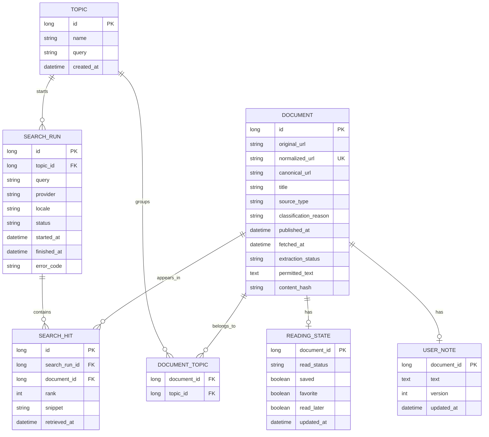

# 데이터 모델 초안

## 관계

## 단계별 적용

2주차에는 `topic`, `search_run`, `search_hit`, `document`만 구현한다. `document_topic`, `reading_state`, `user_note`는 관계와 제약을 검토한 뒤 해당 기능 주차에 추가한다. AI 작업과 근거 테이블은 10주차 범위다.

## 필수 제약

- `document.normalized_url`은 UNIQUE 후보지만 서로 다른 글의 오병합을 막는 규칙이 먼저 필요하다.
- `document_topic`은 `(document_id, topic_id)` 복합 UNIQUE를 사용한다.
- `published_at` 미상은 null이며 수집 시각으로 대체하지 않는다.
- 사용자 메모와 AI 생성 결과는 같은 열에 저장하지 않는다.
- 모든 SQLite 연결에서 foreign keys를 켠다.
